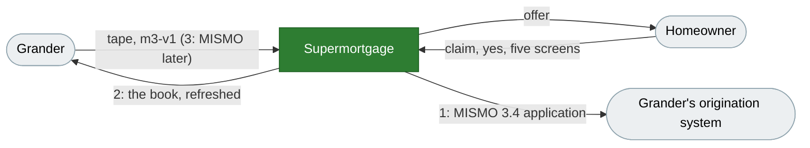

# MISMO, and what it can do for Grander

What MISMO is, what we already do with it, and where mortgage and
application data can add value for Grander, ranked, with the simplest
version of each. Researched 29 October 2026; sources at the end.

## Bottom line

- **MISMO is how mortgage systems talk at the door, not how they work
  inside.** It is one reference model (3.6.3, June 2026) and datasets cut
  from it: the application (ULAD and iLAD, on 3.4), the closing (UCD),
  delivery to Fannie Mae and Freddie Mac (ULDD), the appraisal (UAD), and
  since October 2025 the boarding of a loan at a servicer. Each system
  translates its own tables when a loan crosses a boundary.
- **We already speak it once.** Every decided application is assembled into
  a MISMO 3.4 Desktop Underwriter casefile (`packages/du`). Origination
  systems import that same kind of file: Encompass reads "ULAD / iLAD (MISMO
  3.4)", and its own export is "Export ULAD (DU MISMO 3.4)".
- **For Grander the value is two hand-offs, and neither needs a new data
  model.** When a homeowner says yes, Grander gets a file its systems can
  open. And what homeowners tell us gives Grander a fresher read of its own
  loans. Reading a tape in MISMO can wait until a servicer sends one.
- **None of it pays until homeowners arrive.** No offer can open while
  pricing is a fixture. No homeowner is invited while homeowner mail is off
  on production. One part of the book refresh, a current value per loan,
  needs no homeowner.

## Grander, in one paragraph

Grander (NMLS 1065200) owns the loans on its book, and its tape names the
servicer on each one. It sends a monthly 118-column tape in its own layout
(`m3-v1`): 1,866 loans, $389 million, all as of 30 April 2026. We watch the
book, review every loan each morning for a refinance, and bill 25 basis
points a year. When we submit to Desktop Underwriter, Grander is the
creditor and we are its agent. So Grander can gain two things from us: it
keeps borrowers who would otherwise refinance elsewhere, and it learns
things about its loans that its tape does not say.

How much that first gain is worth: servicers keep about one refinancing
borrower in three. ICE measured 32% in the first quarter of 2026, and 37% on
rate-and-term refinances. The rest pay the loan off to another lender.

## Three moves, ranked

| #   | Move                         | Data flow                        | Grander gets                                               | Effort                    |
| --- | ---------------------------- | -------------------------------- | ---------------------------------------------------------- | ------------------------- |
| 1   | Hand Grander the application | application → Grander            | A refinance it can close without re-keying                 | Small: the file exists    |
| 2   | Refresh Grander's book       | homeowner and property → Grander | Value, occupancy, contact and intent its tape cannot carry | Small to medium           |
| 3   | Read a tape in MISMO         | a servicer's system → us         | Nothing today; the next servicer needs no new profile      | Small now, a reader later |

### 1. A yes reaches Grander as a file it can open

**What.** For each application that starts from a Grander loan, offer the
MISMO 3.4 file we already assemble for Desktop Underwriter. It would be a
download on the loan's page in the Servicer Portal, and readable through the
partner key. Grander imports it into its origination system, so its loan
officer starts from the borrower's answers, the bank report and the decision
instead of a phone call. Grander is the creditor, so the file goes to the
party the application is addressed to.

**Why it is simple.** `emitSubmission` already builds the file from our
tables. It passes the preflight check and round-trips all eighteen of Fannie
Mae's samples. Nothing is stored: like the DU submission, the file is built
when someone asks for it.

**What it needs.**

- **The name of Grander's origination system,** and one test import there.
- **The demographic section.** We ask the URLA's demographic questions
  (`demographics` on the borrower), but the assembler sends none. DU's spec
  carries the `HMDA*` elements. Grander is the creditor, so it reports these
  applications under HMDA, and the file it receives should carry them.
- **The taxpayer identifier.** A DU file names each borrower's Social
  Security number, and nothing in the repo holds one yet (`ssn_vault_handle`
  points at nothing). Until the vault exists, the hand-off can go without it
  and the loan officer asks for it.

### 2. Grander's book, refreshed

Grander's tape is what its servicer recorded, and it is months old. Every
loan is as of 30 April. The value is a BPO or "Current FMV" with its own
date, and occupancy is the servicer's code. On production the daily review
marks Grander's verdicts `value_stale`, meaning the value on file is more
than 24 months old (measured 28 October). A homeowner who claims a loan and
starts a refinance tells us things that are current and first-hand.

| What we learn                           | From                               | Refreshes, in the tape's words | Shareable                                                  |
| --------------------------------------- | ---------------------------------- | ------------------------------ | ---------------------------------------------------------- |
| A current value for every loan          | the property port, by address      | Current FMV, its date          | If CoreLogic's terms allow it; 1,866 valuations a month    |
| The offer's answer: yes, not now, never | the offer card                     | nothing; it is new             | Yes; the portal's loan page already shows it               |
| The homeowner can be reached            | the claim, screen 2                | Srv Last Contact Date          | Yes                                                        |
| Occupancy, answered and signed          | screen 4: Section 5, the residence | Current Occupancy              | Yes, once the borrower applies                             |
| Income, assets, credit                  | the bank report, the credit pull   | Current Fico, DTI              | Only inside the application (move 1), never in the refresh |

**What it is worth.** A current value is the input the daily review is
missing, and for an investor it is a current loan-to-value on every loan. An
occupancy that contradicts the tape is a risk Grander cannot see from the
tape. A homeowner we can reach is a retention lead, and a "never" is someone
to stop marketing to.

**Simplest version.** One page and one CSV in the portal, one row per loan,
with columns named as Grander's tape names them, so the refresh drops into
the sheet Grander already keeps. The value row is the only one that needs
no homeowner, and it is the one to price first.

**The line.** We share only what a homeowner gave us about Grander's loan,
after the claim. A homeowner who never claims shares nothing. A consumer
report is pulled for one application and stays with it. Counsel should read
this table before the occupancy and contact rows ship. Treat it as a
proposal.

### 3. A tape in MISMO, when a servicer can send one

MISMO published the Loan Boarding Data Segment of its Industry Transfer of
Servicing Dataset on 2 October 2025, on the 3.6 reference model, and added
wrapper files on 28 May 2026. It lines up with the GSEs' delivery dataset
(ULDD) and Ginnie Mae's pool delivery dataset. MISMO estimates it saves $60
to $160 a loan in rework. Servicing systems will add it as an export over
time.

**For Grander, not now.** Its tape works: the reader knows all 118 columns
and both real defects found so far. Asking Grander to change formats would
cost it effort and give it nothing.

**What to do now.** Put a MISMO 3.6 path beside each field of the feed
contract (`ImportedLoanRecordSchema` in `@hm/shared/portfolio`). The
servicing app's sample transfer already gives illustrative paths for its
boarding tape (`apps/servicing/fixtures/transfer-batch-demo/LAYOUT.md`), and
its boarding mapper targets those paths. After that, a servicer that sends a
MISMO file needs only a new profile beside `m3-v1`. Write the reader when a
servicer actually sends one.

## Not now

| Dataset                                    | What it is                                                    | Why not                                                           |
| ------------------------------------------ | ------------------------------------------------------------- | ----------------------------------------------------------------- |
| ULDD (3.0), UCD (3.3)                      | Delivering a closed loan to the GSEs; the Closing Disclosure  | Grander's origination system does both at closing; we close none  |
| UAD 3.6                                    | The appraisal                                                 | Our value is an AVM; an appraisal arrives as the appraiser's file |
| Servicing transfer, FGHA Servicing Dataset | Moving servicing; servicing data for FHA, VA and USDA         | Grander's book is watched, never boarded                          |
| BWIC template, PL RMBS                     | Bid lists for MBS; rating-agency data for private-label deals | Grander's capital markets work, not our door                      |
| MISMO as our internal model                | MISMO's containers as our tables                              | Our tables already answer the DU graph (`docs/du-graph.md`)       |

## The license

We build on MISMO's schemas (`packages/du-schema` vendors five of them)
under a decision, not a signed license (`docs/du-readiness.md`). MISMO
requires a license from anyone who builds technology on its standards.
Membership is $3,500 a year and includes a license, plus the member-only
field lists for the Loan Boarding Data Segment and iLAD 2.5. Grander needs
no license, because it uses MISMO only through vendor software. So: one
membership for us, bought before move 1 reaches a real borrower.

## What to do, in order

1. Ask Grander which origination system it uses, and whether it wants the
   application as a download or through the partner key.
2. Price CoreLogic for a monthly value on 1,866 loans, and ask whether we
   may pass the value on to Grander.
3. Join MISMO and have someone read the license.
4. Build move 1: the download and the demographic section. It pays once a
   pricing vendor lets an offer open.
5. Build move 2's rows on the portal and in a CSV, the value first, after
   counsel reads the line.
6. Add MISMO paths to the feed contract. Hold off on the reader until a
   servicer sends a MISMO file.

## Sources

- MISMO: [Dataset Specifications](https://www.mismo.org/standards-resources/residential-specifications/datasets);
  [Loan Boarding Data Segment](<https://www.mismo.org/standards-resources/mismo-product/loan-boarding-data-segment-of-the-industry-transfer-of-servicing-dataset-(itsd)>);
  [iLAD 2.5.0](<https://www.mismo.org/standards-resources/mismo-product/industry-loan-application-dataset-(ilad)-2.5.0>);
  [Federal Government Housing Agency Servicing Dataset](https://www.mismo.org/standards-resources/residential-specifications/datasets/federal-government-housing-agency-servicing-dataset);
  [BWIC template](https://www.mismo.org/standards-resources/residential-specifications/datasets/bwic-template-mapping-specification);
  [PL RMBS](https://www.mismo.org/standards-resources/residential-specifications/datasets/private-label-rmbs-valuation);
  [Reference Model 3.6.3](https://www.mismo.org/standards-resources/mismo-product/mismo-version-3.6.3-reference-model);
  [License FAQs](https://mismo.org/standards-resources/additional-tools-and-resources/about-mismo-licenses/mismo-license-faqs).
- MBA on MISMO: [loan boarding dataset, 2 October 2025](https://www.mba.org/news-and-research/newsroom/news/2025/10/02/mismo-releases-loan-boarding-dataset-to-solve-for-costly-errors-occurring-during-servicing-transfers);
  [wrapper files, 28 May 2026](https://www.mba.org/news-and-research/newsroom/news/2026/05/28/mismo-introduces-wrapper-files-to-enable-consistent-loan-boarding);
  [3.6.3, 2 June 2026](https://www.mba.org/news-and-research/newsroom/news/2026/06/02/mismo-updates-reference-model-with-enhancements-for-servicing--property-data--and-va-workflows).
- Fannie Mae: [URLA / ULAD FAQs](https://singlefamily.fanniemae.com/learning-center/delivering/faqs-uniform-residential-loan-application-uniform-loan-application-dataset)
  (iLAD as the superset of ULAD and the AUS specs).
- ICE: [Export ULAD (DU MISMO 3.4)](https://help.icemortgagetechnology.com/documentation/encompass/Content/encompass/Export_ULAD_DU_MISMO_3_4.htm);
  [Encompass 22.1 release notes](https://help.icemortgagetechnology.com/documentation/encompass/Content/encompass/release_notes/previous-releases/22-1/rn_feature-enhancements.htm)
  (the "ULAD / iLAD (MISMO 3.4)" import);
  the May 2026 Mortgage Monitor, as [reported by Mortgage News Daily](https://www.mortgagenewsdaily.com/news/05152026-service-retention-ice-mortgage-monitor).
- Missouri Division of Finance, [licensee 1065200-S](https://finance.mo.gov/licensee/details/211).
- In this repo: `packages/partner-book/src/m3-v1.ts`, `packages/du`,
  `apps/api/src/services/refinance.ts`, `docs/product-suite.md`,
  `docs/subservicer-data.md`.
