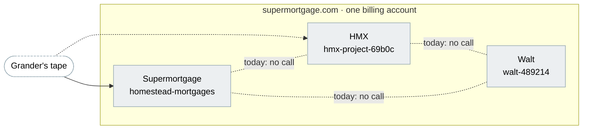

# Supermortgage, HMX and Walt together

Three products, three repos, one Google Cloud organization. What each is,
what they share today, the doors each has, and how they can work together
through those doors. Each repo's `docs/product-suite.md` is the detail;
this page is the map. Measured 28 October 2026.

| Product       | For                                                  | Repo                            | Project               | Door                                                   |
| ------------- | ---------------------------------------------------- | ------------------------------- | --------------------- | ------------------------------------------------------ |
| Supermortgage | homebuyers, homeowners, servicers (Grander), staff   | `Walt-Home/Homestead-Mortgages` | `homestead-mortgages` | `app.supermortgage.com`, `servicing.supermortgage.com` |
| HMX           | investors, data buyers, MSR holders (Grander), staff | `Walt-Home/HMX`                 | `hmx-project-69b0c`   | `app.thehmx.com`, `analytics.thehmx.com`               |
| Walt          | homeowners, developers, staff                        | `Walt-Home/Walt`                | `walt-489214`         | `prod.trywalt.ai`                                      |

The pages: [Supermortgage](product-suite.md),
[HMX](https://github.com/Walt-Home/HMX/blob/main/docs/product-suite.md),
[Walt](https://github.com/Walt-Home/Walt/blob/remove-homestead/docs/product-suite.md)
(on the `remove-homestead` branch, Walt-Home/Walt#3, until that merges).

## One account, three projects, nothing else shared

All three projects sit in the organization `supermortgage.com`
(`601394808997`) on one billing account (`018EFB-8252A5-192332`). That is the
whole of what they share. Each has its own Cloud Run services, Cloud SQL
instance, service accounts, secrets and sign-in, and no code in any of the
three calls either of the others.

| Project               | Cloud Run                                                      | Cloud SQL                                  | Sign-in                           |
| --------------------- | -------------------------------------------------------------- | ------------------------------------------ | --------------------------------- |
| `homestead-mortgages` | 4: API and servicing app, staging and production; 10 jobs      | 2 instances, 2 databases each              | Google plus an authenticator code |
| `hmx-project-69b0c`   | 2: API, staging and production; static apps in buckets         | 2 instances, private IP only               | Firebase, e-mail or Google        |
| `walt-489214`         | 4: Walt and the American Homestead app, staging and production | 1 instance, `walt_prod` and `walt_staging` | E-mail and password, or Google    |

Supermortgage left Walt's project in September because a Cloud SQL user is
instance-scoped and the shared runtime account held project-wide secret and
storage roles. The American Homestead app still lives in Walt's project on
the same database and account; HMX never did. The separation is the design:
connect the three through APIs and IAM grants, never through a shared
database or service account.

## The doors each product has

| Product       | Who may call, and how                                                                                                                                                                                                                                                                                                                                                                            |
| ------------- | ------------------------------------------------------------------------------------------------------------------------------------------------------------------------------------------------------------------------------------------------------------------------------------------------------------------------------------------------------------------------------------------------ |
| Supermortgage | People: a session (`/api/*`), a servicer's team (`/api/servicer`). Machines: a servicer's bearer key at `/api/partner/*` (send a tape, read imports, mint a claim). Inbound: Stripe at `/api/webhooks/invoicing`. Outbound: its own calls to the servicing app carry a Google identity token on `X-Serverless-Authorization`, and Cloud Run's IAM checks it. `GET /api/health` names the commit. |
| HMX           | People: a Firebase ID token as a bearer (`/api/*`). Open: health and the `/api/discover` listings. Inbound: Stripe and Securitize webhooks. No API keys, no OAuth clients, no door for another service.                                                                                                                                                                                          |
| Walt          | People: a session cookie (`/api/*`). Machines: `walt_live_` bearer keys with scopes and tiers at `/api/v1/*`, outbound webhooks signed HMAC-SHA256. Open: `/api/public/earnings`, `/api/public/fleet`. Internal: cron and power-reading routes behind shared secrets. No health endpoint.                                                                                                        |

Two of the three already have a machine door. Supermortgage's is for a
servicer and Walt's is for a developer; HMX has none. Supermortgage is also
the only one that calls another Cloud Run service, and it does so the way
Google intends inside one organization: the caller's service account holds
`run.invoker` on the callee, and the token is minted from the metadata
server, with no shared secret. That pattern works across projects in the
same organization, and it is the one to reuse.

## How they can work together

Each is a call through a door that exists or one named here, in the order
the pieces are ready.

1. **One tape, read once.** Grander's monthly tape reaches Supermortgage's
   tape desk and is normalized onto its feed contract; HMX Analytics takes a
   CSV of the same tape through an admin upload. Make Supermortgage the
   system of record for a servicer's book and give HMX Analytics a partner
   key (`npm run partner:key`) to read it through `/api/partner/book/*`,
   extended with a read of the book itself. HMX's firm account for Grander
   then starts from the tape Supermortgage already holds, as of the same
   date, instead of a second upload.
2. **A service door on HMX and Walt.** Add to each one middleware that
   accepts a Google identity token from a named service account
   (Supermortgage's `hm-run@`, HMX's `hmx-production-api@`, Walt's
   `walt-cloud-run@`) and grant `run.invoker` across projects. After that
   every call among the three carries IAM, not a shared secret, and
   revoking one is an IAM change.
3. **Walt's Home Graph for HMX's lead engine.** HMX's lead engine defers
   about forty categories for want of signals, and names Walt as one. Walt's
   Developer API serves documents, properties, financial facts and insights
   behind a scoped key. HMX holds one `walt_live_` key in Secret Manager and
   reads the Home Graph for homeowners who have consented; HMX anonymizes
   per pool as it already does for AI Data.
4. **Two verdicts on one loan.** Supermortgage's daily review says whether a
   loan should refinance; HMX Analytics says what the servicing right is
   worth across 108 lead categories. Show both on the Servicer Portal's loan
   page: Supermortgage reads HMX's `/api/analytics` through the door in step
   2, keyed on the servicer's loan number, the key both already use.
5. **A Walt homeowner becomes a Supermortgage applicant.** Walt reads the
   mortgage statement and knows the home; Supermortgage prefills screen 1
   from a loan and a tape and runs the refinance. The intake Supermortgage
   has today starts from a servicer's tape, not a homeowner's upload, so this
   needs a new one, and the claim rule in `docs/decisions.md` ("A mortgage is
   claimed by a token the servicer delivers") needs counsel before Walt
   delivers anything on a servicer's behalf. Build it after 1 to 4.
6. **One sign-in, later.** Three products, three sign-ins. The organization
   makes a shared Google identity possible, but Supermortgage's second step
   is a rule and HMX's is Firebase; nothing here needs it first.

What stays apart on purpose: databases, service accounts and secrets. A
product that needs another's data asks for it through a door and gets back
what that door is allowed to say, which for a servicer's book means the
anonymized rows until a homeowner has claimed their loan.

## What the shared account gives us

- One bill, one organization policy set, one place for IAM. The
  `iam.allowedPolicyMemberDomains` constraint applies to all three; it is why
  Supermortgage's public borrower app needed a project-level exception.
- Cross-project grants: `run.invoker`, `secretmanager.secretAccessor` and
  bucket roles can be granted to a service account in another project, so
  step 2 is IAM, not plumbing.
- Workload Identity Federation per project for GitHub Actions, no key files,
  in all three already.

What it does not give: a shared network, a shared database or a shared
identity, and it should not. Walt's project is the one place where two apps
still share a database and a runtime account, and the Walt page lists
finishing that separation among its next steps.

## What's next, in order

1. Decide that Supermortgage is the system of record for a servicer's tape,
   and mint HMX Analytics a partner key.
2. The service door on HMX and Walt (step 2 above), and `run.invoker`
   grants across the three projects.
3. HMX reads Walt's Home Graph through a scoped developer key.
4. Supermortgage's verdict and HMX's analysis on one Servicer Portal page.
5. Health endpoints that name the commit on HMX and Walt, as Supermortgage's
   does, so a page like this can be measured from three URLs.
6. The Walt homeowner intake, after counsel on the claim rule.

## Measured

- The three product-suite pages, each written 28 October 2026 from the code,
  the deployed health endpoints, `gcloud` read-only and, where a database was
  read, counts only.
- `gcloud organizations list`, `gcloud projects list` and
  `gcloud billing projects describe` for the three projects; `gcloud run
services list` and `gcloud sql instances list` in each.
- A search of this repo for `trywalt`, `thehmx` and the two project ids:
  mail domains and one e-mail address, no call. The HMX and Walt pages make
  the same statement about their repos.
