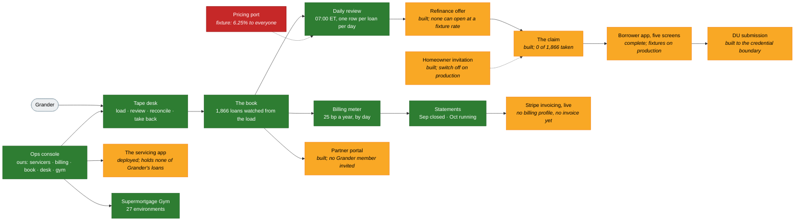

# The product suite, and what works today

Every product in this repo as a product rather than a package, where each
stands, and what of it works end to end for our first partner, Grander.
Measured 28 October 2026 at `007466d`, the commit both environments report
at `/api/health`. **Update it in the commit that changes what it says**, the
way `docs/du-readiness.md` is kept: a status page that lags the code gets
believed.

## The bottom line

- **Three products run for Grander on production today, on its real tape and
  with no fixture in the path:** the tape desk (1,866 loans loaded,
  reconciled and repaired), the book meter and its monthly statements, and
  the daily review over every loan.
- **Four more are live as capability and have not touched Grander:** the
  partner portal (nobody from Grander is invited), Stripe invoicing (live
  since 5 October; Grander has no billing profile, so no invoice can be
  drafted), the homeowner invitation (the switch is off on production; 0 of
  1,866 loans claimed), and refinance offers (the review quotes the
  fixture's 6.25%, so no offer can open; 0 have).
- **The borrower app is a complete flow and not yet fit for a real
  borrower.** On production the identity check runs in Stripe test mode,
  credit, payroll, IRS, e-sign, screening, liens, pricing and Desktop
  Underwriter are fixtures, qualifying income reads $0, and every decision
  ends Referred.
- **The Supermortgage Gym is 27 training environments** graded by our own
  engines, built to the 26 October cutoff and served to staff in the console.
  It is a product for AI labs, not for a servicer.

## Where it stands

🟢 running for Grander on production, no fixture in the path · 🟡 built and
tested, with a named gap before it is real · 🔴 a fixture, a switch or a
missing row that keeps the lane from being real · ⚪ a fact, not a verdict

## For Grander, today

Production, 28 October 2026. Counts are the production database's, read once
that day through the Cloud SQL Auth Proxy in a read-only session, counts
only, no personal data; the loan-review job's log at 07:03 Eastern agrees.

| Lane                    |     | Today                                                                                                              |
| ----------------------- | --- | ------------------------------------------------------------------------------------------------------------------ |
| Tape loaded             | 🟢  | Five tapes standing, a sixth taken back, all as of 30 April 2026; 1,866 loans, $389,393,880.02 UPB; 2 rows refused |
| Book watched            | 🟢  | 1,866 reviews a day since 26 October, every loan, all still unclaimed                                              |
| Verdicts                | 🟡  | Today 1,834 not now, 17 excluded, 15 watching, 0 candidates: the quote is the fixture's 6.25%                      |
| Offers                  | 🔴  | 0 opened. None can open until the pricing port is real                                                             |
| Analyst                 | 🔴  | Off: production holds no model key; 1,866 skipped as `model_off`                                                   |
| Homeowner invitations   | 🔴  | `homeownerMail: off` on production, by rule; 0 of 1,866 loans claimed; nobody has been written to                  |
| Billing meter           | 🟢  | September closed at $13,755.22 (the first 245 loans); October running at $81,123.49                                |
| Run rate                | 🟢  | ARR $973,481.88 at the newest balances, labeled an estimate on the page                                            |
| Invoice                 | 🔴  | Stripe live, two-admin send; 0 invoices drafted. A draft needs a billing profile, and there is none                |
| Billing profile and ACH | 🔴  | No profile row: no legal name, billing e-mail or Stripe customer, so no bank account can be set up                 |
| Portal team             | 🔴  | Nobody from Grander invited; the portal has no members                                                             |
| Staff console           | 🟢  | First admin stood by the deploy; three staff invited, one removed; the tapes were loaded at the desk               |
| Live servicing read     | 🟡  | Depth is API, so the port asks the servicing app, which holds no loans there: asked and empty                      |
| Open defect             | 🔴  | Loan 1023991155 was refused at load for a blank term; its batch needs re-sending with the term                     |
| Borrowers               | ⚪  | One Google sign-in on production, 0 applications, 0 decisions: no real borrower has walked the app                 |

What that adds up to: Grander's book is in, correct, metered and reviewed
every morning, and Grander itself has not been touched: no member in the
portal, no billing profile, no invoice, no homeowner written to. The first
three are the Servicers page, in that order; the fourth is a decision.

## The suite

| Product                          | What it is                                                                                                                                      | Where                                                                            |     | Today                                                                                     |
| -------------------------------- | ----------------------------------------------------------------------------------------------------------------------------------------------- | -------------------------------------------------------------------------------- | --- | ----------------------------------------------------------------------------------------- |
| Borrower app                     | Five screens, Google sign-in plus an authenticator, co-borrowers, the payroll / IRS / upload branches, a decision that explains itself          | `app.supermortgage.com`, `apps/web`                                              | 🟡  | Complete flow; fixtures on production; 0 applications there; every decision ends Referred |
| My Loan and the claim            | A watched mortgage on the home page, the loan page with the tape's figures and our verdict, the offer card, `/claim` for a servicer's token     | `apps/web/src/pages/LoanPage.tsx`, `ClaimPage.tsx`                               | 🟡  | Built and seeded on staging; 0 real claims                                                |
| Refinance from an offer          | A yes opens our five screens prefilled from the loan and the tape, `prior_loan_id` set at birth                                                 | `services/refinance.ts`, `services/refi-offers.ts`                               | 🟡  | Built; no offer has opened on a real book                                                 |
| Desktop Underwriter submission   | Assemble, gate, emit, send, record after every decision; a refusal is a row                                                                     | `packages/du`, `services/du-submission.ts`                                       | 🟡  | Fixture answers; no taxpayer vault; institution and NMLS placeholders refused             |
| Partner API                      | A bearer key for a servicer's machine: send a tape, read imports and status, mint a claim                                                       | `/api/partner/*`, `npm run partner:key`                                          | 🟢  | Grander's door; the desk uses the same service                                            |
| Tape desk                        | Files, review, load, team, invite; a book's tapes added up; a tape taken back; numbers renumbered; near-duplicates refused                      | `/console/tape`, `routes/console-tape.ts`, `services/tape-desk.ts`               | 🟢  | Loaded and repaired Grander's book on production                                          |
| Daily refinance review           | The spec's refinance rules, pure over the kernel; one append-only row per loan per day; the analyst's record when a model key is set            | `packages/refi-review`, `services/loan-review.ts`, job at 07:00 ET               | 🟢  | Runs over 1,866 loans every morning; quote is a fixture; analyst off                      |
| Refinance offers                 | A candidate becomes a `refi_offers` row for thirty days, delivered on a claimed loan; yes / not now / never with the spec's cooldowns           | `services/refi-offers.ts`, `POST /api/loans/:id/offers/:offerId/answer`          | 🟡  | Built; 0 on production                                                                    |
| Homeowner invitation             | One claim per unclaimed loan, mailed to the supplement's address, held by a switch and a typed count                                            | `inviteToClaim` in `services/tape-desk.ts`, `HOMEOWNER_MAIL`                     | 🟡  | Off on production by rule; on for staging to our own domains                              |
| Billing meter and statements     | The price sheet (version 1.1) as data; 25 basis points a year on interest-bearing UPB by calendar day; one statement per servicer per month     | `packages/billing`, `services/billing.ts`, `/console/billing`                    | 🟢  | September closed, October running, run rate shown and explained                           |
| Invoicing                        | A closed statement drafted at Stripe, approved by one admin, sent by another; void, paid, credit notes; webhook inbox and hourly reconciliation | `services/billing-invoices.ts`, `stripe-invoicing.ts`, `/api/webhooks/invoicing` | 🟡  | Live on production since 5 October; no invoice drafted, no billing profile to draft from  |
| ACH on file                      | A servicer's bank account through Stripe's hosted setup page; the only payment method                                                           | `bankSetupLink`, portal "Set up ACH payments"                                    | 🟡  | Built; Grander has no billing profile yet, so no account                                  |
| Partner portal                   | A servicer's team: code and password sign-in; loans, a page per loan, billing and invoices, team                                                | `/console/portal`, `/api/servicer`, `services/servicer-team.ts`                  | 🟡  | Built and tested both ways; no Grander member invited yet                                 |
| Servicers page                   | Add a servicer before its first tape; manage its team, billing profile and bank account any day after                                           | `/console/servicers`, `pages/ServicersPage.tsx`                                  | 🟢  | How Grander was stood up                                                                  |
| Ops console, our pages           | Servicers, Billing, Partner book, the desk, the Gym, staff invitations and resends                                                              | `apps/console`, `/console/hm/*`                                                  | 🟢  | Live on both hosts behind the staff session                                               |
| Ops console, the servicing app's | Queue, Work items, Loans, People, Compliance, Controls, AI, Staff, Access review, proxied to the servicing app's console API                    | `apps/api/src/console-host.ts`                                                   | 🟡  | Empty on production: the servicing app's database holds no loans there                    |
| Staff sign-in                    | A code to an invited address, mailed by us, then a password; invited on any domain; removed by a mark                                           | `console-host.ts`, `services/console-staff*.ts`, `console_staff_invitations`     | 🟢  | `staffSignInCodes: mailed` on both environments                                           |
| The servicing app                | The vendored runtime on its own database and door; the sweep every five minutes; every vendor in it a fake                                      | `apps/servicing`, `servicing.supermortgage.com`                                  | 🟡  | Deployed both environments; demo book on staging only; holds none of Grander's            |
| The Supermortgage Gym            | 27 environments as a page: a case, the right answer, how the AI did, try it yourself                                                            | `/console/hm/gym/`, `packages/environments/playground`                           | 🟢  | Built to the 26 October cutoff; staff build carries no recorded attempts                  |
| RL environments                  | Tasks, primitive tools and graders over synthetic loans, in three groups: refinance, servicing, lending                                         | `packages/environments`, `docs/environments.md`                                  | 🟢  | 27 registered; held-out baselines recorded; the eval key is at its cap until 1 Nov        |
| Requirements engine              | The 85 requirements of the V1 flow sheet, generated, three-valued applicability                                                                 | `data/v1-build.csv`, `packages/requirements`                                     | 🟢  | Verified in CI on every push                                                              |
| Shadow AUS                       | Ratios, reserves, compliance tests and pricing, every figure from a recorded derivation; `refer` when any input is blocked                      | `packages/underwriting`                                                          | 🟡  | Escrow is a national average; the LLPA grid is illustrative; thresholds dated 2025        |
| Connectors                       | Fifteen ports behind one authorization guard; real adapters where a contract exists                                                             | `packages/connectors`                                                            | 🟡  | Seven answered by a real service on production, one in test mode; eight fixtures          |
| Average prime offer rate         | Fetched daily from the CFPB's published table and cross-checked against Appendix J; never typed                                                 | `scripts/fetch-apor.ts`, job at 12:00 UTC                                        | 🟢  | Covers the current week on both environments                                              |
| Brand                            | Tokens, Tailwind preset and `.super-*` components; contrast floors as tests                                                                     | `packages/brand`, `docs/brand.md`                                                | 🟢  | Generated CSS verified in CI                                                              |
| Two environments                 | One Terraform module instantiated twice; four hostnames on one front door; promote-by-commit with a summary before the gate                     | `infra/`, `deploy.yml`, `deploy-production.yml`                                  | 🟢  | Both report `007466d`; the `production` tag moved on 28 October                           |

### Which vendors are real, on each environment

From `/api/health` on 28 October. "Fixture" answers the same three addresses
or the same sample report to everyone; nothing is sent.

| Port         | Staging                                                | Production                        |
| ------------ | ------------------------------------------------------ | --------------------------------- |
| identity     | Stripe Identity, test mode                             | Stripe Identity, **test mode**    |
| bank         | Plaid consumer report, sandbox                         | Plaid consumer report, production |
| propertyData | Google Places, CoreLogic record and AVM; flood fixture | the same                          |
| aporSeries   | CFPB published table                                   | the same                          |
| mail         | Resend, our own domains only                           | Resend                            |
| servicing    | the servicing app, staging                             | the servicing app, production     |
| invoicing    | Stripe, sandbox                                        | Stripe, **live**                  |
| credit       | fixture                                                | fixture                           |
| payroll      | fixture                                                | fixture                           |
| irs          | fixture                                                | fixture                           |
| esign        | fixture                                                | fixture                           |
| screening    | fixture                                                | fixture                           |
| liens        | fixture                                                | fixture                           |
| pricing      | fixture, 6.25% to everyone                             | fixture, 6.25% to everyone        |
| du           | fixture                                                | fixture                           |

## What is not 100%, by product

The gaps a buyer or a partner would meet, in the order they bite.

1. **Pricing is a fixture.** Every review quotes 6.25% and every file is
   priced off an illustrative LLPA grid. It is the one input that keeps the
   refinance lane from producing an offer on Grander's book, and the engine
   from quoting anybody. `docs/decisions.md`, "Pricing is a port, and the
   vendor is still unpicked".
2. **No homeowner is written to.** The invitation is built and held three
   ways, and production's switch is off by rule. Turning it on is a decision
   about mail to Grander's customers, not code.
3. **Qualifying income reads $0.** Plaid's report is read and its streams
   are mapped, but no step decides an income source's continuance, so DTI is
   pending and every decision ends Referred. `docs/testing.md` says so on
   the screen.
4. **The identity check is test mode on production.** A real borrower would
   see Stripe's sample outcomes.
5. **Credit, payroll, IRS, e-sign, screening and liens are fixtures.** Seven
   vendor decisions, each needing a contract. `docs/decisions.md`, "Still
   outstanding".
6. **Desktop Underwriter is a fixture.** The casefile round-trips and the
   transport is built, but there is no vault for taxpayer identifiers and the
   institution and NMLS values are placeholders refused in production.
   `docs/du-readiness.md`.
7. **Grander has no billing profile, no bank account and no invoice.**
   September's statement is closed, but a draft needs the profile (legal
   name, billing e-mail, a Stripe customer) and there is no row. The
   Servicers page is where it is entered; the ACH setup link follows it;
   then drafting, approving and sending are three presses by two admins.
8. **Grander's team is not in the portal.** No member has been invited, so
   nobody at Grander can see their loans, their verdicts or their bill. The
   invitation is the Servicers page or the desk's Team step, and it mails
   to a servicer's address with the homeowner switch off.
9. **The book is April's.** Every tape loaded is as of 30 April 2026, so
   every value reads stale and delinquency is counted to that date. A
   current tape from Grander is the fix, and the reader now refuses the
   number spelling that made 245 loans twice.
10. **The servicing app holds nothing of Grander's.** Its console pages are
    empty on production because a partner's book is watched, never boarded.
    The servicing environments describe engines that do not act on Grander's
    loans today.
11. **The analyst is off on production.** No model key is set there, and the
    evaluation key is at its spending cap until 1 November.
12. **Escrow is a national average, the thresholds are dated 2025, business
    days ignore federal holidays, the flood zone is never determined.**
    `docs/decisions.md`, "Assumed, and load-bearing" and "Known wrong, and
    shipped anyway".
13. **No regulatory notice is generated or delivered, and no monitoring loop
    re-pulls.** The clocks that a notice would stop open tolled.
    `docs/states.md`, "Built, or not".
14. **Roles.** The console has one role on purpose; the borrower app has
    none, so an underwriter cannot open a file.

## How this was measured

- `https://app.supermortgage.com/api/health` and the staging one: `commit`,
  `providers`, `connectorModes`, `personas`, `homeownerMail`,
  `staffSignInCodes`, `invoicingEvents`, `apor`.
- The production jobs' last executions, all succeeded: loan review daily at
  07:00 Eastern (28 October: "reviewed 0 of 1866 monitored loans and
  analyzed 1866 of 1866 unclaimed … 0 offers opened … skipped: 1866
  model_off"), billing reconciliation hourly ("0 invoice(s) read"), APOR
  fetch daily, billing close on 1 October, the servicing sweep every five
  minutes.
- The deploy of `007466d`: CI run 40552248426, every job green (check, three
  API shards, four servicing shards, deploy-servicing, deploy); production
  promotion on 28 October, four jobs green including the tag move.
- Locally, 28 October: `npm run check` passes (85 requirements, the brand
  tokens, six DU tables, the APOR survey, the servicing app's types), and
  every workspace suite but the API's and the servicing app's passes: 153
  test files across thirteen workspaces, none failing. The API suite needs
  a local Postgres and was not run here; CI ran it green on this commit.
- The production database, read once on 28 October through the Cloud SQL
  Auth Proxy with the session read-only, counts only, no personal data: one
  servicer at depth API; 1,866 loans, all `IMPORTED_UNCLAIMED`; five tapes
  standing and one removal, all as of 30 April 2026; 0 portal members; no
  billing profile; one statement (September, $13,755.22, sheet 1.1, closed
  7 October); 0 invoices; 0 claims; 0 offers; 1,866 reviews a day since 26
  October under `hm.refi-review.v3`; three staff invitations, one removed;
  1 user, 0 applications, 0 decisions. The balance figure is the 27 October
  repair's, recorded in `docs/decisions.md`, "A tape can be taken back, and
  a loan number is digits".

Where this page and the code disagree, the code wins and this page is stale.
