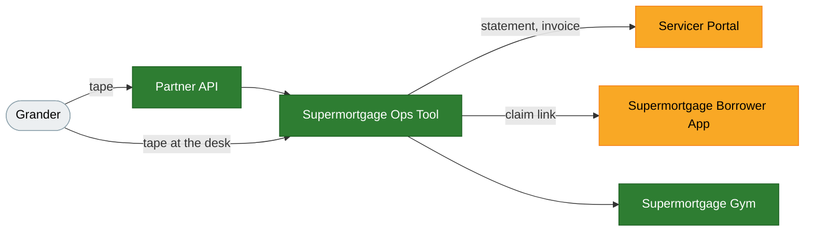

# The Supermortgage product suite

Five products, what each does, and what works today. Measured 28 October
2026 at `007466d`, the commit both environments report. Update it in the
commit that changes what it says.

| Product                    | For                       | Where                                        |     | Today                                                         |
| -------------------------- | ------------------------- | -------------------------------------------- | --- | ------------------------------------------------------------- |
| Supermortgage Borrower App | homebuyers and homeowners | `app.supermortgage.com`                      | 🟡  | Whole flow built; most vendors are fixtures; no applicant yet |
| Servicer Portal            | a servicer's team         | `servicing.supermortgage.com/console/portal` | 🟡  | Built; nobody at Grander invited yet                          |
| Supermortgage Ops Tool     | our staff                 | `servicing.supermortgage.com/console`        | 🟢  | Loaded, reviews and meters Grander's book                     |
| Partner API                | a servicer's systems      | `/api/partner`, a bearer key                 | 🟢  | Grander's door for tapes and claims                           |
| Supermortgage Gym          | AI labs, and us           | `/console/hm/gym/`, claude.ai                | 🟢  | 27 environments, baselines recorded                           |

🟢 running on production with no fixture in the path · 🟡 built, with a gap
named below · 🔴 blocked by a fixture, a switch or a missing row

## Grander, today

| Lane             |     | Today                                                                           |
| ---------------- | --- | ------------------------------------------------------------------------------- |
| The book         | 🟢  | 1,866 loans from five tapes, all as of 30 April 2026; one tape taken back       |
| The daily review | 🟢  | Every loan, every morning since 26 October; 0 candidates at the fixture's 6.25% |
| The charge       | 🟡  | On the whole principal: September $13,784.63 once reclosed, October $81,175.22  |
| Invoice          | 🔴  | None. Grander has no billing profile, so none can be drafted                    |
| The sheet        | 🟡  | $43.04/month apart: loan 1023991155 is off the book for a blank term            |
| Portal           | 🔴  | No member invited                                                               |
| Refinance offers | 🔴  | 0. The pricing port is a fixture                                                |
| Homeowners       | 🔴  | 0 invited, 0 claimed. The switch is off on production, on purpose               |
| Open defect      | 🔴  | Loan 1023991155 refused at load for a blank term; needs its batch again         |

The book is in, correct, metered and reviewed. Grander itself has not been
touched: no profile, no invoice, no member, no homeowner written to.

## Supermortgage Borrower App

A homebuyer applies in five screens: the property, about you, your bank, a
few questions, review and sign. A homeowner on a servicer's book sees their
mortgage, each morning's verdict and any refinance offer; a yes opens the
same five screens prefilled.

- Sign-in is Google plus an authenticator code. A co-borrower is named on
  screen 2 and walks their own half from a mailed link.
- The bank screen is Plaid's consumer report. The property card is Google
  Places and CoreLogic. The ID check is Stripe Identity. Rent, prior income
  and phone are offered back from what we already hold, never filled in.
- Every decision explains its figures, and every decision is assembled into
  a Desktop Underwriter casefile and submitted.

What does not work yet

- On production the ID check runs in Stripe's test mode, and credit,
  payroll, IRS, e-sign, screening, liens, pricing and DU are fixtures.
- No step decides an income source's continuance, so qualifying income
  reads $0 and every decision ends Referred.
- A co-borrower cannot be invited on production while homeowner mail is off.
- One person has signed in on production. No application exists there.

## Servicer Portal

A servicer's team signs in with a code to their e-mail and a password, on
the same door as our staff, and sees four things: their loans, a page per
loan (its tapes, each morning's verdict and why, its offers, the homeowner's
invitation), billing (this month so far and an invoice per closed month),
and their team, which they grow and prune. ACH is set up through Stripe's
hosted page. Nothing else is writable.

What does not work yet

- Nobody at Grander has been invited. The invitation is sent from the Ops
  Tool's Servicers page or the tape desk's Team step.
- Grander has no billing profile, so the billing page has no bank account
  to set up and no invoice to show.

## Supermortgage Ops Tool

Our staff's console. Staff are invited by address; sign-in is a code we
mail, then a password.

- **Tape desk.** Files, review, load, team, invite. A book's tapes add up on
  one page; a tape can be taken back; loan numbers are renumbered; a tape
  that respells numbers the book already holds is refused.
- **Servicers.** Add a servicer before its first tape; manage its team,
  billing profile and bank account any day after.
- **Billing.** The meter — 25 basis points a year on the whole principal,
  interest-bearing plus deferred, a month at a time and never pro-rated by
  day — one statement per servicer per month, the run rate, and how each is
  computed.
  An invoice is drafted at Stripe, approved by one admin and sent by
  another; credit notes; void; paid by hand. Live at Stripe since 5 October.
- **Partner book, Staff, Gym.** The book as we hold it; invitations and
  removals; the Gym for staff.
- **The servicing app's pages.** Queue, work items, loans, people,
  compliance, controls, AI, access review, proxied to the servicing app.

What does not work yet

- The servicing app's pages are empty on production: its database holds no
  loans there, because a partner's book is watched and never boarded.
- No invoice has been drafted, for want of Grander's billing profile.
- The desk's invite step is held off on production until the homeowner mail
  switch is turned on. That is a decision, not code.

## Partner API

A servicer's machine presents a bearer key and sends a tape, reads what each
import made, and mints a single-use claim link for one loan. It is the same
service the tape desk calls. Grander's tapes have come through the desk so
far.

## Supermortgage Gym

Twenty-seven training environments, each a real mortgage job an AI
practices on and our own engine grades: refinance review, escrow analysis,
payment posting, Flex Modification, ARM changes, payoff statements, MI
removal, credit reporting, early-intervention deadlines, transfer review,
tape review, call review, contact audit, qualifying income, Reg Z price
tests and the AUS decision, with harder versions of several. Every loan is
synthetic. The page shows a case, the right answer and how it is worked
out, how often the AI is right on the held-out suite, and lets a person try
the case. In the Ops Tool for staff without the model's recorded attempts;
on claude.ai with them. Built to the 26 October cutoff; the follow-up list
is in `docs/environments.md`.

## Under the hood

| Engine                      |     | Today                                                                                                                                                              |
| --------------------------- | --- | ------------------------------------------------------------------------------------------------------------------------------------------------------------------ |
| Requirements engine         | 🟢  | The flow sheet's 85 requirements, generated and verified in CI                                                                                                     |
| Shadow AUS                  | 🟡  | Every figure from a recorded derivation; escrow is a national average, the LLPA grid is illustrative                                                               |
| Daily refinance review      | 🟢  | The spec's rules over the kernel, one row per loan per day at 07:00 Eastern                                                                                        |
| Billing meter and invoicing | 🟢  | The price sheet (1.1) as data; Stripe live in production, sandbox on staging                                                                                       |
| DU submission               | 🟡  | Casefile round-trips and submits to the fixture; no taxpayer vault, placeholder institution and NMLS values                                                        |
| Connectors                  | 🟡  | Fifteen ports. Real: bank, property, APOR, mail, servicing, invoicing, identity (test mode). Fixtures: credit, payroll, IRS, e-sign, screening, liens, pricing, DU |
| The servicing app           | 🟡  | The vendored runtime, deployed beside the API in both environments with fake vendors; 0 loans on production                                                        |
| Platform                    | 🟢  | Two environments from one Terraform module, four hostnames, promote by commit, health names the commit                                                             |

## What's next, in order

1. Grander's billing profile and bank account, on the Servicers page.
2. Invite Grander's team to the portal.
3. Draft, approve and send September's invoice.
4. A current tape from Grander, with the blank-term loan's batch.
5. A pricing vendor. Until then no offer can open and no file can be quoted.
6. Turn on homeowner mail, when that is decided.
7. The borrower vendors (credit first) and the DU contract values.

## Measured

- `/api/health` on both hosts: commit, providers, modes, switches.
- Production's jobs, all succeeded: the loan review at 07:03 Eastern on 28
  October ("analyzed 1866 of 1866 unclaimed … 0 offers opened"), the hourly
  billing reconciliation ("0 invoice(s) read"), the daily APOR fetch, the
  billing close on 1 October, the servicing sweep every five minutes.
- The production database, read once, read-only, counts only: 1,866 loans
  all unclaimed, five tapes and one removal, 0 portal members, no billing
  profile, one statement, 0 invoices, 0 claims, 0 offers, 1,866 reviews a
  day since 26 October; the servicing app's database, 0 loans. October's
  charge and the run rate through the billing service's own read path.
- CI green on `007466d`; promoted to production 28 October. Locally `npm run
check` and every workspace suite but the API's pass; CI ran the API's.
